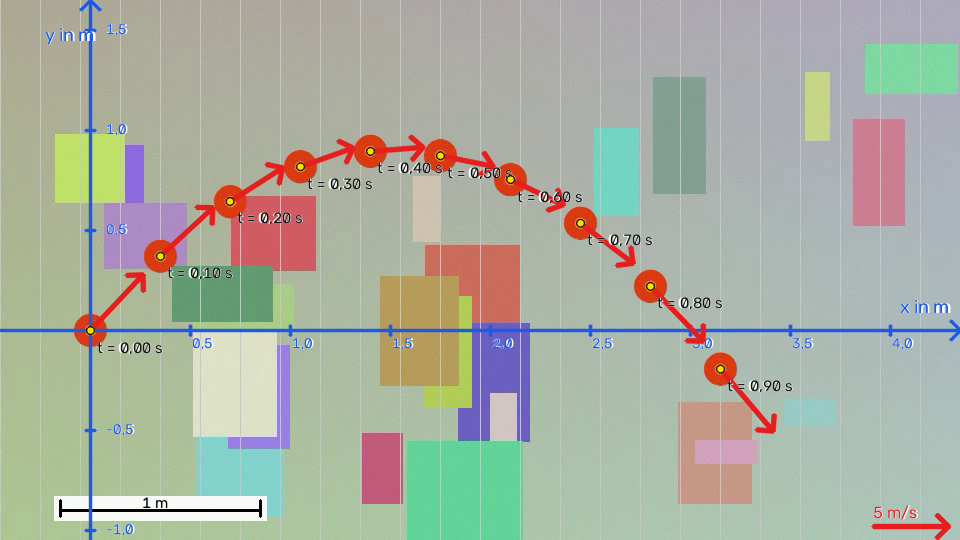
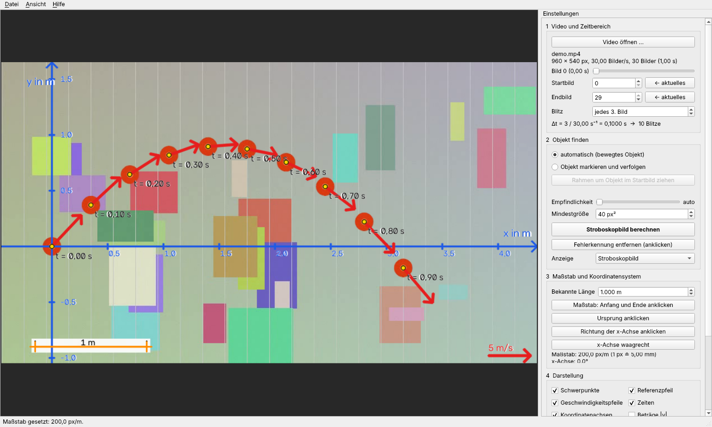

# Strobosoft

Video-Stroboskop für den Physikunterricht: Aus einem Video, in dem sich ein
Objekt bewegt, entsteht ein Stroboskopbild – das Objekt erscheint zu den
Zeitpunkten t₀, t₀ + Δt, t₀ + 2Δt, … auf einem gemeinsamen Hintergrund.
Mit Maßstab und Koordinatensystem schätzt das Programm die
Geschwindigkeitsvektoren und zeichnet sie als Pfeile ein.



## Funktionen

- Videos laden (mp4, mov, avi, mkv, …), Zeitbereich und „jedes n-te Bild“ wählen
  (Δt = n / Bildrate)
- Hintergrund als Median über viele Bilder – das bewegte Objekt verschwindet
- Objekt automatisch erkennen (Differenz zum Hintergrund) **oder** per Rahmen
  markieren und mit dem CSRT-Tracker verfolgen
- Stroboskopbild: Objekt-Ausschnitte mit weicher Kante auf den Hintergrund
  setzen, Deckkraft einstellbar, Fehlerkennungen per Klick entfernen
- Maßstab per zwei Klicks auf eine bekannte Strecke, Ursprung und Richtung der
  x-Achse frei setzbar (y zeigt nach oben)
- Geschwindigkeit zentral `(r₊ − r₋) / 2Δt` oder vorwärts `(r₊ − r) / Δt`,
  Pfeile mit Referenzpfeil (z. B. „1 m/s“), Achsen mit Teilstrichen
- Export als **PNG**, **SVG** (Pfeile und Achsen als bearbeitbare Vektoren)
  und **CSV** (t, x, y, vx, vy, |v|; wahlweise mit Semikolon und Dezimalkomma
  für deutsches Excel)



## Installation und Start

Python 3.10 oder neuer wird benötigt.

```bash
python -m venv .venv
# Windows: .venv\Scripts\activate    macOS/Linux: source .venv/bin/activate
pip install -r requirements.txt
python -m strobosoft            # optional: python -m strobosoft mein_video.mp4
```

Alternativ: `python run.py` im Projektordner.

### Windows mit VS Code

1. Projektordner in VS Code öffnen (**Datei → Ordner öffnen**).
2. Einmalig im Terminal (PowerShell):
   ```powershell
   python -m venv .venv
   .venv\Scripts\Activate.ps1
   pip install -r requirements.txt
   ```
   Falls PowerShell das Aktivieren verweigert, vorher
   `Set-ExecutionPolicy -Scope Process -ExecutionPolicy RemoteSigned` ausführen.
3. Unten rechts bzw. mit `Strg+Umschalt+P` → „Python: Interpreter auswählen“
   den Interpreter aus `.venv` wählen.
4. Starten mit **F5** (Startkonfiguration „Strobosoft starten“) oder
   `run.py` öffnen und auf ▶ klicken.

Zum Ausprobieren ohne eigenes Video: **Datei → Beispielvideo erzeugen**. Das
erzeugt einen schiefen Wurf; der schwarze Balken unten links ist genau 1 m lang.

## Ablauf

1. Video öffnen, mit dem Schieberegler Start- und Endbild übernehmen,
   Schrittweite n wählen.
2. **Stroboskopbild berechnen.** Klappt die automatische Erkennung nicht
   (z. B. weil noch eine Person durchs Bild läuft), „Objekt markieren und
   verfolgen“ wählen und einen Rahmen um das Objekt ziehen.
3. Für Angaben in Metern: bekannte Länge eintragen und deren Anfang und Ende
   anklicken. Ohne Ursprung gilt der erste Objektpunkt als Ursprung.
4. Darstellung anpassen und exportieren.

## Tipps für gute Videos

- Kamera auf ein Stativ, nicht zoomen oder schwenken.
- Ruhiger, kontrastreicher Hintergrund; das Objekt sollte sich deutlich abheben.
- Maßstab (Meterstab o. Ä.) in der Bewegungsebene ins Bild legen.
- Kurze Belichtungszeit (viel Licht bzw. Zeitlupe) gegen Bewegungsunschärfe.
- Smartphones nehmen manchmal mit variabler Bildrate auf; Strobosoft rechnet
  mit der mittleren Bildrate des Videos.

## Entwicklung

```bash
pip install -r requirements.txt pytest
python -m pytest
```

Die Tests erzeugen ein synthetisches Wurfvideo mit bekannter Bahn und prüfen
Positionen (< 1,5 px) und Geschwindigkeiten (< 0,08 m/s Abweichung).

Aufbau des Codes und Hinweise für eine spätere Portierung nach Rust:
[docs/ARCHITEKTUR.md](docs/ARCHITEKTUR.md).
